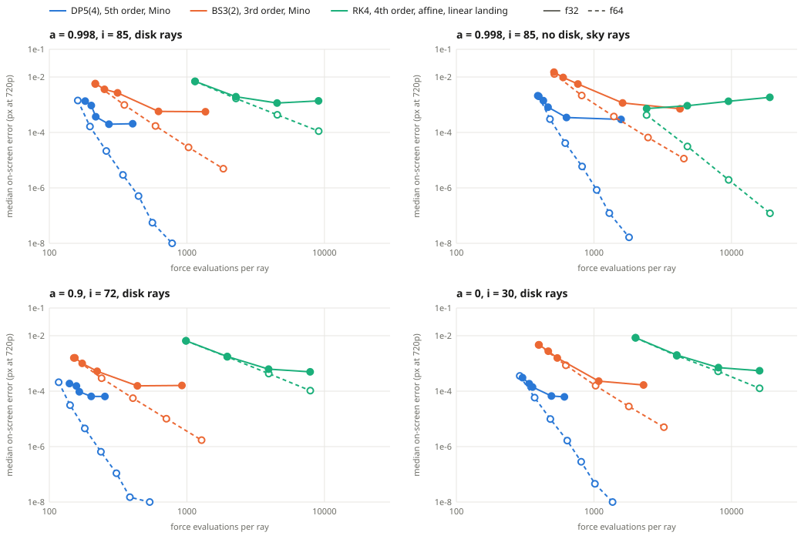

# What limits accuracy on a GPU ray tracer: f32 rounding or integrator order? (2026-11-06)

Follow-up to `../2026-11-06-conserved-drift/`, which found that conserved-quantity drift is mostly f32 evaluation error, amplified near the horizon because a fixed error in Boyer-Lindquist variables corresponds to a large H there. This experiment scores what a ray actually delivers instead: where it lands on screen.



## Answer

Neither, at the shipped settings, in the way the question assumed. There are three regimes, and order is not the deciding factor in any of them:

| Tolerance | What limits the f32 renderer | Evidence |
|---|---|---|
| 1e-3 | Truncation | f32 and f64 agree |
| **1e-5 (shipped)** | **Truncation, because f32 noise switches off the step controller's drift check.** State rounding comes second. | f64 arithmetic with only f32's noise floor reproduces most of the GPU error |
| 1e-6 and tighter | **A rounding wall, set by storing the state in f32** | Rounding only the store gives nearly the whole wall; compensated summation lowers it 2x to 3x |

Going from 3rd to 5th order, in the same equations, lowers the wall only about 2.5x.

**The exception is rays passing almost over the pole.** They reach whole-pixel errors at the shipped tolerance. Most of that is truncation; the wildest tail is rounding.

**In absolute terms the ordinary error is tiny:** at the shipped tolerance the 99th percentile is 5e-4 to 9e-3 of a 720p pixel, depending on the view and ray type.

## Method

The same 4,304 rays per view go through every arm: a 64 x 36 grid, 1,700 rays log-spaced from 1e-4 to 1 M off the critical curve, and 300 rays with |alpha| from 1e-5 to 0.03 (near the pole). All alpha and beta values are exactly representable in f32, so an arm's error is its own and not the rounding of the pixel coordinate.

Score: on-screen displacement in pixels of the app's 720p view, through the reference's own Jacobian at each ray, plus fate flips. Disk rays report the hit point, sky rays their direction. Medians are over the ray type shown; the near-pole rays are reported separately.

| Arm | Runs on | Purpose |
|---|---|---|
| DP5(4), Mino equations, tol 1e-3 to 1e-7 (f64 to 1e-9) | GPU f32, CPU f64 | the shipped integrator |
| DP5(4) with compensated state (two-sum), same tolerances | GPU f32 | the direct test of the wall |
| BS3(2), same equations, error norm and landing | GPU f32, CPU f64 | the clean order test |
| RK4, affine Hamiltonian, linear disk landing, step scale 1 to 1/8 | GPU f32, CPU f64 | the pre-Mino renderer |
| Rounding switches: force, increment, store, mirror's pi, each alone and combined | CPU | which rounding sets the wall, measured |
| f64 arithmetic with only f32's drift-check noise floor | CPU | what f32 does to the step controller |
| f64 with f32 ray constants; f64 result rounded to f32 | CPU | what the inputs and the output format cost |

## Results

### 1. Median error, a = 0.998, i = 85, disk rays (attempts per ray in brackets)

| Tolerance | 1e-3 | 1e-4 | **1e-5 (shipped)** | 1e-6 | 1e-7 |
|---|---|---|---|---|---|
| DP5 f64 | 1.4e-3 (27) | 1.6e-4 (33) | **2.1e-5 (43)** | 2.9e-6 (57) | 5.1e-7 (74) |
| DP5 f64, f32 noise floor only | 1.5e-3 (27) | 1.0e-3 (28) | **2.8e-4 (31)** | 7.8e-5 (40) | 6.3e-6 (53) |
| DP5 f32 | 1.3e-3 (30) | 9.4e-4 (34) | **3.7e-4 (36)** | 2.0e-4 (45) | 2.1e-4 (67) |
| DP5 f32, compensated | 1.3e-3 (31) | 9.0e-4 (35) | **2.9e-4 (37)** | 1.1e-4 (47) | 7.5e-5 (68) |
| BS3 f32 | 5.8e-3 (72) | 3.6e-3 (84) | 2.7e-3 (104) | 5.7e-4 (207) | 5.6e-4 (455) |

### 2. At the shipped tolerance: the drift check

The step controller has two tests: an error norm at the stated tolerance, and a first-integral drift check at 1e-3 of it, floored at the rounding noise so a step is not rejected for rounding alone. In f64 that floor is negligible and the drift check is the stricter test. In f32 the floor is far above it, so the check rarely binds and the controller takes longer steps.

| View (rays) | f64 | f64 with f32's noise floor | f32 wall (tol 1e-7) | Those two combined in quadrature | GPU f32 |
|---|---|---|---|---|---|
| a = 0.998 (disk) | 2.1e-5 | 2.8e-4 | 2.1e-4 | 3.5e-4 | 3.7e-4 |
| a = 0.998, no disk (sky) | 4.1e-5 | 6.6e-4 | 2.9e-4 | 7.2e-4 | 8.1e-4 |
| a = 0.9 (disk) | 4.5e-6 | 6.0e-5 | 6.4e-5 | 8.8e-5 | 9.5e-5 |
| a = 0 (disk) | 9.8e-6 | 1.3e-4 | 6.2e-5 | 1.4e-4 | 1.4e-4 |

The third column has no f32 arithmetic in it. So the 14x to 21x gap between f32 and f64 at the shipped tolerance is mostly f64 being stricter than its stated tolerance, not f32 rounding directly. The quadrature column is an empirical match, not a derivation.

### 3. The wall: rounding switches at tol 1e-7

Exact arithmetic except where named. "Everything" also rounds the ray constants and output, and must reproduce the GPU or the split would mean nothing.

| Rounding on | a = 0.998 disk | a = 0.998 sky | a = 0.9 disk | a = 0 disk |
|---|---|---|---|---|
| Force only | 3.4e-5 | 4.5e-5 | 8.2e-6 | 9.8e-6 |
| Increment arithmetic only | 2.2e-5 | 2.6e-5 | 7.9e-6 | 9.8e-6 |
| **State store only** | **1.8e-4** | **2.3e-4** | **5.9e-5** | **5.8e-5** |
| Mirror's f32 pi only | 7.8e-7 | 6.9e-5 | 1.1e-7 | 3.1e-7 |
| Force + increment, no store | 4.0e-5 | 5.1e-5 | 1.2e-5 | 1.3e-5 |
| Everything | 2.0e-4 | 2.4e-4 | 6.2e-5 | 6.0e-5 |
| GPU f32 | 2.1e-4 | 2.9e-4 | 6.4e-5 | 6.2e-5 |

The store sets the wall. The CPU model with everything on matches the GPU to within 4 % on the disk rays and about 20 % on the sky rays. The mirror's pi (8.7e-8 off, applied at each equator crossing) only matters on rays that cross repeatedly with no disk to stop them.

### 4. Compensated summation lowers the wall

Two-sum on each state component, with the lost bits fed into the next increment and every stage's argument, and the pi error corrected at each mirror. Median and p99, GPU:

| View | Plain, tol 1e-7 | Compensated, tol 1e-7 | Gain (median, p99) | iGPU median | Gain at shipped tol |
|---|---|---|---|---|---|
| a = 0.998 disk | 2.1e-4, 1.7e-3 | 7.5e-5, 5.2e-4 | 2.8x, 3.3x | 7.4e-5 | 1.3x |
| a = 0.998 sky | 2.9e-4, 3.1e-3 | 1.9e-4, 2.0e-3 | 1.5x, 1.6x | 1.0e-4 | 1.1x |
| a = 0.9 disk | 6.4e-5, 4.9e-4 | 2.9e-5, 1.5e-4 | 2.2x, 3.2x | 2.9e-5 | 1.5x |
| a = 0 disk | 6.2e-5, 3.6e-4 | 2.6e-5, 1.0e-4 | 2.4x, 3.5x | 2.4e-5 | 1.0x |

- **Sky rays are limited by the direction calculation after that:** computing the direction in f64 from the same compensated state gives 7.8e-5, against 1.9e-4 as rendered.
- **Why not the full 5x the switches allow:** what remains on disk rays is about what force and increment rounding (4.0e-5), ray constants (4.2e-5) and output format (4.4e-5) give together, 7.2e-5 in quadrature at a = 0.998 against 7.5e-5 measured.
- **Little gain at the shipped tolerance,** as section 2 predicts: truncation is in charge there.
- **Cost:** attempts per ray stay within about 1 of plain (up to 5 fewer in one case). Time per dispatch was within noise on both GPUs, but those runs are about 60 ms and dominated by queue overhead, so that is a sanity check and not a frame benchmark.

### 5. Order

| View (rays) | DP5 f32 wall | BS3 f32 wall | Ratio | BS3 / DP5 accepted steps | BS3 / DP5 force evaluations |
|---|---|---|---|---|---|
| a = 0.998 disk | 2.0e-4 | 5.6e-4 | 2.8x | 5.6x | 2.3x |
| a = 0.998 sky | 2.9e-4 | 7.1e-4 | 2.4x | 6.3x | 2.7x |
| a = 0.9 disk | 6.4e-5 | 1.6e-4 | 2.5x | 5.1x | 2.2x |
| a = 0 disk | 6.2e-5 | 1.7e-4 | 2.7x | 5.9x | 2.2x |

From the older RK4, which differs in variables and landing as well as order:

- **Sky rays, f64:** about 14x to 16x per step halving: true 4th order.
- **Disk rays, f64:** only about 4x per halving: 2nd order, set by the linear disk landing rather than by RK4.
- **Sky rays, f32:** error *rises* as steps shrink (7.3e-4, 9.2e-4, 1.3e-3, 1.8e-3), which looks like rounding accumulating with step count.

### 6. The exception: rays that graze the pole

Near-axis rays (|alpha| < 0.03) at the shipped tolerance, p99 / max px:

| View | f64 | f64, f32 noise floor | GPU f32 | GPU compensated | Compensated at tol 1e-7, p99 |
|---|---|---|---|---|---|
| a = 0.998 disk | 0.88 / 1.0 | 4.8 / 6.1 | 4.1 / 5.5 | 4.2 / 6.0 | 1.1e-3 |
| a = 0.998 no disk | 0.14 / 0.20 | 0.79 / 1.9 | 5.4 / 69 | 0.63 / 2.1 | 3.2e-4 |
| a = 0.9 disk | 0.35 / 0.48 | 1.3 / 1.9 | 1.1 / 1.6 | 1.2 / 1.8 | 3.2e-4 |
| a = 0 disk | 0.17 / 0.36 | 0.63 / 0.92 | 13 / 80 | 0.63 / 1.1 | 2.0e-4 |

The 1 to 6 px errors appear with the noise floor alone, so they are truncation. The extreme tail (13 and 80 px at a = 0, 69 px at a = 0.998 with no disk) disappears under compensation, so that part is rounding. The damage is concentrated at |alpha| < 1e-3.

- **Reach in the app:** at 1x zoom the nearest jittered ray to the axis is |alpha| = 4.9e-3 M, outside the worst band, so this should not be visible by default. At 16x zoom that distance falls to 3e-4 M, inside it, and a 1x pixel is 16 zoomed pixels. This is a prediction from the numbers; **it has not been looked for on screen.**
- **Reliability:** the largest values are not trustworthy as pixel figures. The check that the Jacobian holds fails for the 80 px and 69 px rays, so those are only "large", and they differ between GPUs (80 px vs 13 px maximum). The a = 0.998 disk rays above 3 px pass it (worst ratio 0.35).

### 7. Options for the renderer, none applied

Median gain against what ships, and extra attempts:

| View | Tol 1e-6 | Tol 1e-6, compensated | Tol 1e-7, compensated | Extra attempts, tol 1e-6 / 1e-7 |
|---|---|---|---|---|
| a = 0.998 disk | 1.9x | 3.2x | 4.9x | +25 % / +86 % |
| a = 0.998 no disk | 2.3x | 2.7x | 4.3x | +36 % / +239 % |
| a = 0.9 disk | 1.5x | 2.6x | 3.3x | +22 % / +54 % |
| a = 0 disk | 2.1x | 2.8x | 5.4x | +37 % / +70 % |

Only tol 1e-7 cures the near-pole rays, and they are one pixel column at most.

### 8. Double-single: "why not just emulate f64?"

Every quantity as a pair of f32 (about 48 bits): state, stage sums, force, drift check and landing, with the step size in double-single too. It runs on the same f32 GPU hardware, through WGSL with no 64-bit type.

Median px, with attempts per ray in brackets, a = 0.998 disk rays:

| Tolerance | 1e-3 | 1e-4 | 1e-5 | 1e-6 | 1e-7 | 1e-8 | 1e-9 |
|---|---|---|---|---|---|---|---|
| f64 | 1.4e-3 (27) | 1.6e-4 (33) | 2.1e-5 (43) | 2.9e-6 (57) | 5.1e-7 (74) | 5.6e-8 (94) | 5.6e-9 (130) |
| Double-single | 1.4e-3 (27) | 1.6e-4 (33) | 2.1e-5 (43) | 2.9e-6 (57) | 5.1e-7 (74) | 5.5e-8 (94) | 5.6e-9 (130) |
| Double-single, stored in f32 | 1.4e-3 | 1.7e-4 | 4.9e-5 | 4.4e-5 | 4.4e-5 | 4.4e-5 | 4.4e-5 |

- **It reproduces f64 to the limit of the test,** in all four views: the same attempts per ray (one differs by 1, at a = 0.9, tol 1e-9) and the same errors. Near-pole rays match f64 too (a = 0.998 at tol 1e-5: 0.88 / 1.0 px on both).
- **This independently confirms section 2.** With the noise floor gone, the controller takes f64's steps, not f32's.
- **But the renderer shades from f32.** Storing the result in f32 sets a new floor: 4.4e-5, 4.6e-6, 9.7e-6 and 1.5e-5 px across the views. Double-single at the shipped tolerance, stored in f32, beats shipped f32 by 8x to 20x.

Cost, microseconds per ray on the RTX, from a 64,000-ray batch (16,000 for double-single, scaled), best of 3, in large batches so queue overhead does not dominate:

| View | Plain, 1e-5 | Compensated, 1e-5 | Double-single, 1e-5 | DS / plain | Plain, 1e-7 | Compensated, 1e-7 | Double-single, 1e-7 | DS / plain |
|---|---|---|---|---|---|---|---|---|
| a = 0.998 disk | 0.38 | 0.40 | 10.0 | 26x | 0.58 | 0.62 | 14.4 | 25x |
| a = 0.998 no disk | 0.44 | 0.41 | 24.2 | 55x | 1.05 | 1.16 | 38.6 | 37x |
| a = 0.9 disk | 0.43 | 0.42 | 10.8 | 25x | 0.42 | 0.40 | 16.4 | 39x |
| a = 0 disk | 0.43 | 0.42 | 19.8 | 46x | 0.38 | 0.41 | 32.4 | 85x |

So double-single costs 25x to 85x plain f32, while compensation stays within about 10 % (in both directions, so that is near this test's noise). These are kernels on the same rays, not frames of the renderer. The iGPU repeats were stopped by low memory and did not finish, so these timings and the double-single accuracy numbers are RTX only.

The arithmetic is checked on the GPU against exact values: every operation within 0.7 units of 2^-44 over 4,096 operand pairs.

## Open questions

- **Why the two GPUs differ on compensated sky rays** (1.9e-4 against 1.0e-4). The direction calculation is the next limit there, and its built-in sin and cos are the obvious candidate, not proven.
- **Why a lower order raises the wall.** Between methods the wall ratio matches the square root of the step ratio (2.3x to 2.5x against 2.4x to 2.8x), which suggests a random walk in the store. But within a method the wall stays flat as steps grow (DP5 36 to 55 steps, BS3 202 to 437 at a = 0.998), so that cannot be the whole story.
- **Whether the near-pole column is visible** at 16x zoom.

## Corrections to earlier versions of this note

- "f32 at the shipped tolerance is 14x to 21x worse because of rounding" is true as a gap and wrong as a cause: see section 2.
- "State rounding, by elimination" is now measured (section 3), and it holds for the wall but not at the shipped tolerance.
- The idea that the wall was the f32 output format was wrong by about 300x on sky rays.

## Limits

- Four views, 4,304 rays each, two GPUs. DP5 medians on ordinary rays agree between GPUs to about 1.4x, except compensated no-disk sky rays (1.9x). Sky-ray p99s as rendered differ by up to 5x (a = 0, 4.2e-3 against 2.1e-2). Near-axis maxima do not agree.
- Geometry only. A displacement is not a colour error; emission gradients decide what it does to a pixel.
- f32 RK4 uses the shipped monitor at every step scale, f64 RK4 a monitor tightened with the step. A tightened monitor in f32 sits below rounding noise and only rejects, so that run was discarded.
- The CPU switches model arithmetic in f32 but keep the controller's own norm and the landing iteration in f64.
- Pixel-coordinate rounding is excluded by design. It adds to the f32 arms in the real renderer.

## Self-checks

- **Reference:** DP5 f64 at tol 1e-11. Self-convergence against 1e-12: median 2e-10 px, max 2.7e-8 px, no flips. Against the independent Hamiltonian code on 173 rays per view: median 9e-10 px on the sky-only view, 5e-5 px on the views with a disk (the independent code's own linear landing), no flips; 1 to 9 of those rays did not converge in that code. So below 5e-5 px on disk views, the reference rests on self-convergence alone.
- **Compensated kernel:** with compensation off it reproduces plain f32 exactly at every tolerance in all views. The two-sum probe is exact on 2,048 of 2,048 pairs on both GPUs, 2,022 with a nonzero error term, so the compilers did not simplify it away; the error term is live on 100 % of rays in the real kernel.
- **Rounding model:** everything on reproduces the GPU (table in section 3).
- **Method order** (`tests/mino-order.test.ts`): measured local error goes as h^4 for BS3 and h^6 for DP5, and the default stays bit-identical to DP5.
- **Fate flips,** DP5 f32: 0 of 4,304 at the shipped tolerance on both GPUs in all four views; at most 2 at tighter tolerances. Compensated: at most 1 at any tolerance.
- **Renderer untouched:** every renderer shader and `gpu.ts` byte-identical to main; `?golden` PASS, 8 of 8 on the recording adapter; 10 of 10 app checks on the normal page. `npm test`: 318 passed, 14 skipped (before the double-single section). `setMinoMethod`, `setMinoRounding` and `minoTraceRay` are CPU-only and off by default.

## Re-run

```
npx vite-node scripts/limit-cpu.ts edge-998       # also edge-998-nodisk, default-9, schw: 6 to 12 min each, side by side
npx vite-node scripts/limit-eps.ts edge-998       # the noise-floor arm, seconds; adds to data/
npx vite                                          # dev server for the GPU arms
node scripts/limit-run.mjs edge-998               # add "igpu" for the integrated GPU: about 20 s each
node scripts/limit-ds-run.mjs edge-998            # double-single: about 3 to 5 min each, adds to results/
node scripts/limit-plot.mjs                       # redraws limit-cost.svg
```

`results/` holds every arm's statistics and the per-ray near-axis scan. `data/` (rays, references, Jacobians) is regenerated by the first two commands and not committed.
